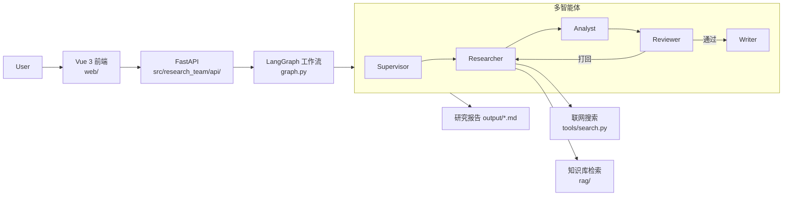

# Research Team

基于 LangGraph 的多智能体研究报告团队：给定研究主题，由 Supervisor 调度 Researcher / Analyst / Reviewer / Writer 协作，结合联网搜索与本地知识库（RAG），产出结构化研究报告。后端 FastAPI，前端 Vue 3 + Vite。

## 架构图



> TODO: 替换为正式架构图图片 `docs/images/architecture.png`

## 启动方式

### 后端

```bash
pip install -e .
cp .env.example .env   # 填入 OPENAI_API_KEY / OPENAI_BASE_URL / MODEL_NAME
python server.py       # http://127.0.0.1:8000
```

### 前端

```bash
cd web
npm install
npm run dev            # 默认 http://127.0.0.1:5173
```

## 截图

| 页面 | 截图 |
| --- | --- |
| 对话 / 研究发起页 |  |
| 报告生成过程 |  |
| 报告结果页 |  |

> TODO: 截图放入 `docs/images/` 后替换上方占位。

## 评测

| 指标 | 数值 | 说明 |
| --- | --- | --- |
| 检索命中率 | TBD | `scripts/run_retrieval_eval.py` |
| 端到端报告质量 | TBD | `scripts/run_e2e_eval.py` |
| 单元测试通过率 | TBD | `pytest` |

> 评测结果原始文件见 `eval/results.md`、`eval/e2e_results.md`，正式数字确认后填入上表。
