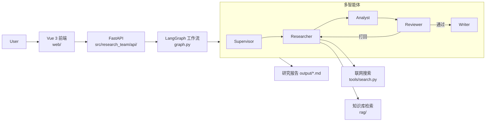

# Research Team

基于 LangGraph 的多智能体研究报告团队：给定研究主题，由 Supervisor 调度 Researcher / Analyst / Reviewer / Writer 协作，结合联网搜索与本地知识库（RAG），产出结构化研究报告。后端 FastAPI，前端 Vue 3 + Vite。

## 架构图



> TODO: 替换为正式架构图图片 `docs/images/architecture.png`

## 启动方式

### 后端

```bash
pip install -e .
cp .env.example .env   # 填入 OPENAI_API_KEY / OPENAI_BASE_URL / MODEL_NAME
python server.py       # http://127.0.0.1:8000
```

### 前端

```bash
cd web
npm install
npm run dev            # 默认 http://127.0.0.1:5173
```

## 截图

| 页面 | 截图 |
| --- | --- |
| 对话 / 研究发起页 |  |
| 报告生成过程 |  |
| 报告结果页 |  |

> TODO: 截图放入 `docs/images/` 后替换上方占位。

## 评测

### 检索评测（77 条正例 / 12 条反例 / 18 个知识库片段，Embedding：`BAAI/bge-m3`）

| 方式 | Recall@3 | Recall@5 | MRR |
| --- | --- | --- | --- |
| vector | 0.935 | 0.961 | 0.852 |
| bm25 | 0.961 | 0.961 | 0.910 |
| hybrid | 0.961 | 0.961 | 0.910 |

命中阈值（vec_min=0.55, bm25_min=5.0）：正例命中率 **0.909**，反例误命中率 **0.000**。

### 端到端评测（20 个主题，模型 `deepseek-ai/DeepSeek-V3`）

| 指标 | 数值 |
| --- | --- |
| 任务完成率 | 100%（20/20） |
| 引用有效率 | 100% |
| 首次审校通过率 | 5% |
| 平均返工次数 | 1.60 |
| 平均耗时 | 112.5s（P50 119.8s / P95 168.1s） |
| 平均 tokens | 8235（输入 5513 / 输出 2722） |

### 单元测试

`pytest`：**56 passed**

> 评测明细见 [eval/results.md](eval/results.md)（检索）与 [eval/e2e_results.md](eval/e2e_results.md)（端到端）；复现脚本：`scripts/run_retrieval_eval.py`、`scripts/run_e2e_eval.py`。
