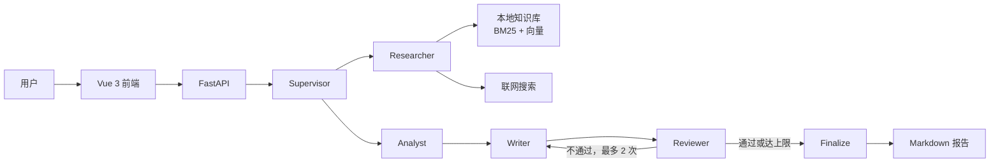

# InsightTeam · 智研团队

[](https://github.com/youxinrui/research-team/actions/workflows/ci.yml)

基于 LangGraph 的多智能体研究报告平台：输入研究主题，由 Supervisor 调度研究员、分析师、写手和审校协作，优先查询本地知识库，未命中的再联网搜索，最终产出带引用来源的 Markdown 报告。支持断点续跑、多轮对话与 Web 界面。

## 功能

- **多智能体协作**：Supervisor 调度 Researcher / Analyst / Writer / Reviewer，通过共享 State 传递结构化数据，而不是自由对话
- **混合检索**：BM25 + 向量检索，RRF 融合；命中阈值由评测集网格搜索确定，未命中自动回退网络搜索
- **审校返工闭环**：审校只拦截三类实质问题（资料外断言、引用不符、结构缺失），最多返工 2 次
- **断点续跑**：基于 LangGraph SqliteSaver，以 run_id 作为 thread_id，中断后从最近完成节点恢复
- **多轮对话**：研究完成后可继续追问、要求修改报告、载入历史会话
- **双端交付**：FastAPI REST API + Vue 3 前端；本地聊天记录存 SQLite

## 架构



Agent 之间不直接对话，只读写共享 `ResearchState`（资料、大纲、草稿、审校结果等字段），每一步都可追踪、可测试。

## 技术栈

| 层 | 选型 |
| --- | --- |
| 编排 | LangGraph、LangChain |
| 模型 | OpenAI 兼容接口（当前 DeepSeek-V3 / 硅基流动） |
| 检索 | BM25（rank_bm25）+ 向量（BAAI/bge-m3）、RRF、jieba 分词 |
| 持久化 | SQLite（LangGraph checkpoint + 聊天记录） |
| 后端 | FastAPI、Uvicorn |
| 前端 | Vue 3、Vite、Element Plus、markdown-it |
| 测试 | pytest（56 个用例） |

## 快速开始

### 后端

```bash
python -m venv .venv
# Windows: .venv\Scripts\activate
source .venv/bin/activate

pip install -e ".[dev]"
cp .env.example .env          # 填入对话模型与 embedding 配置
python -m research_team --ingest knowledge   # 构建知识库索引
python server.py              # http://127.0.0.1:8000
```

接口文档：http://127.0.0.1:8000/docs

### 前端

```bash
cd web
npm install
npm run dev                   # http://127.0.0.1:5173
```

Vite 已把 `/api` 代理到 `127.0.0.1:8000`。

## 使用方式

### 单次研究

```bash
python -m research_team "多智能体系统在软件工程中的应用"
```

### 多轮对话

```bash
python main.py
```

| 命令 | 作用 |
| --- | --- |
| 直接输入主题 | 启动研究 |
| `/ask <问题>` | 基于当前报告提问 |
| `/edit <要求>` | 修改报告并重新审校 |
| `/load <run_id>` | 载入历史会话 |
| `/new <主题>` | 换主题重新研究 |
| `/quit` | 退出 |

### API

| 方法 | 路径 | 说明 |
| --- | --- | --- |
| POST | `/api/sessions` | 提交研究任务，返回 session_id |
| GET | `/api/sessions/{id}` | 查询状态与执行事件 |
| GET | `/api/sessions/{id}/messages` | 获取对话记录 |
| GET | `/api/sessions/{id}/report` | 获取 Markdown 报告 |
| POST | `/api/sessions/{id}/ask` | 追问 |
| POST | `/api/sessions/{id}/edit` | 修改报告 |
| GET | `/api/sessions` | 历史会话列表 |

## 评测

### 检索评测

89 条查询（77 正例 / 12 反例），知识库 18 个片段，Embedding：`BAAI/bge-m3`。

| 方式 | Recall@3 | Recall@5 | MRR |
| --- | --- | --- | --- |
| 纯向量 | 0.935 | 0.961 | 0.852 |
| 纯 BM25 | 0.961 | 0.961 | 0.910 |
| 混合（向量权重 0.1） | **0.961** | **0.961** | **0.910** |

阈值 `vec_min=0.55`、`bm25_min=5.0`：正例命中率 **0.909**，反例误命中率 **0.000**（调优前为 0.583）。阈值与 RRF 权重均由评测集网格搜索确定。

### 端到端评测

20 个主题（10 知识库 / 7 网络 / 3 混合），模型 `deepseek-ai/DeepSeek-V3`：

| 指标 | 数值 |
| --- | --- |
| 任务完成率 | **100%**（20/20） |
| 引用编号有效率 | **100%**（393 处引用，0 处越界） |
| 首次审校通过率 | 5% |
| 平均返工次数 | 1.6 |
| 平均耗时 | 112.5s（P50 119.8s / P95 168.1s） |
| 平均 tokens | 8,235 / 篇 |

### Prompt 调优实验

针对 5 个高返工主题做对照实验（同一批主题、同一模型）：

| 指标 | 调优前 | 调优后（当前默认） |
| --- | --- | --- |
| 首次审校通过 | 0/5 | **3/5（60%）** |
| 最终审校通过 | 1/5 | **4/5** |
| 平均返工 | 2.0 次 | **0.6 次** |
| 平均耗时 | 131.3s | **62.1s（-53%）** |
| 平均 tokens | 10,669 | **5,261（-51%）** |
| 平均报告字数 | 1,895 | 1,406（保留 74%） |

调优内容：写手只使用资料内信息、事实性陈述必须带编号、资料缺口显式标注；审校只对实质问题判不通过。

### 复现

```bash
python scripts/run_retrieval_eval.py
python scripts/run_e2e_eval.py            # 全量 20 条
python scripts/run_e2e_eval.py --ids t04,t13 --out eval/subset
```

明细见 [eval/results.md](eval/results.md) 与 [eval/e2e_results.md](eval/e2e_results.md)。

## 测试

```bash
pytest -q     # 56 passed
```

## Docker

先在宿主机构建前端（镜像不包含 Node，避免额外拉取构建镜像）：

```bash
cd web
npm ci
npm run build
cd ..
docker compose up --build
```

首次启动后构建知识库索引：

```bash
docker compose run --rm app python -m research_team --ingest knowledge
```

镜像内前端由 FastAPI 直接托管（`SERVE_WEB=1`），访问 http://127.0.0.1:8000 即可。`output/` 与 `knowledge/.index/` 通过 volume 持久化。

## 目录结构

```text
src/research_team/
├── agents/          # supervisor / researcher / analyst / writer / reviewer
├── api/             # FastAPI 路由、会话管理、请求模型
├── rag/             # 分块、embedding、向量索引、混合检索
├── evaluation/      # 检索与端到端评测指标
├── tools/           # 联网搜索（360）
├── chat.py          # 多轮对话
├── graph.py         # LangGraph 工作流
├── storage.py       # SQLite 聊天记录
├── persistence.py   # LangGraph checkpointer

web/                 # Vue 3 + Vite 前端
eval/                # 评测集与结果
scripts/             # 评测脚本
knowledge/           # 示例知识库文档
```

## 已知限制

- 当前为本地单用户服务，没有用户隔离与鉴权；公网部署前需要补鉴权与限流
- 知识库为示例文档，检索评测规模有限，阈值在同一评测集上调优（in-sample）
- 界面截图与演示 GIF 待补充
- 未配置模型价格时只统计 token，不计算费用
